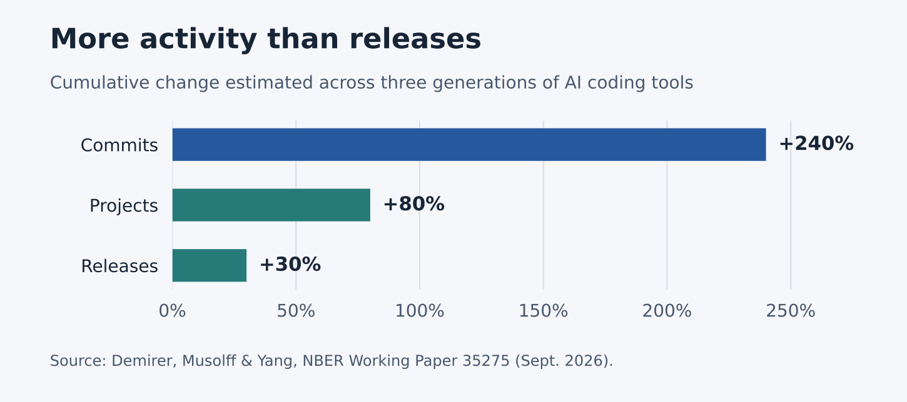
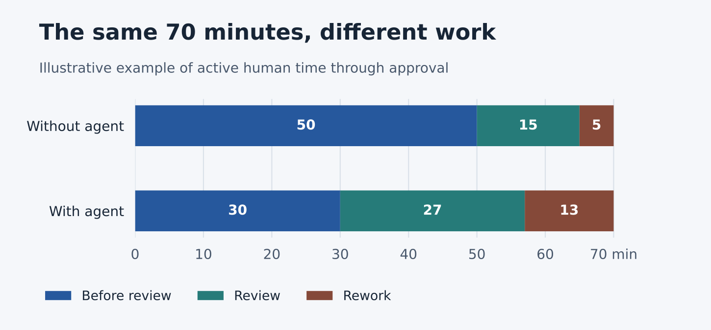

When I work with a coding agent, the feedback loop is tight. I steer it while it implements the change, open a draft pull request, ask Copilot for a review, work through the feedback, and ask it to look again. Once I’m happy with the result, a colleague gets the PR.

That colleague sees the final diff. I have also seen the decisions that led to it: what I asked the agent to change, what it added along the way, and why I kept or dropped a fix for an edge case. By the time I ask for a human review, the changes can span more code than I would expect a colleague to inspect closely in a normal review slot. A polished PR description can make the handoff feel complete while leaving that person to reconstruct most of the reasoning.

_Today, the author iterates with a coding agent, iterates on a draft with a review bot, then hands the full PR to a colleague for a human feedback loop before merge. In the proposed workflow, the team agrees on the specification during refinement, the author uses it to steer a focused change, and a colleague reviews the full diff against the same specification before merge._

## What reviewers are seeing

A preprint published on November 13, 2026, by Kaia Newman and colleagues is the closest thing I found to this experience. It combines 24 interviews with a survey whose analytical pool included 2,590 respondents at one large software company. Among respondents to the relevant items, 60% reported oversized changes more often in the AI-assisted era and 13% less often. For reviews that were less thorough than the reviewer wanted, the split was 47% versus 19%. Respondents generally felt that AI review improved individual reviews, yet using AI for review was uncorrelated with an improved ability to keep up with the volume. These are self-reports from one company, with a 9% response rate including partial responses. [Newman et al., November 2026 preprint](https://arxiv.org/abs/2611.18939)

## More coding activity, a smaller increase in releases

A September 2026 NBER working paper by Mert Demirer, Leon Musolff, and Liyuan Yang combined GitHub activity and AI usage data for more than 500,000 developers. Its matched event study estimated about 240% more commits, 80% more projects, and 30% more releases after adoption across three generations of tools, from autocomplete to autonomous agents. These are cumulative observational estimates. The paper also finds evidence of more experimentation, with some additional work abandoned along the way. The gap between commits and releases by itself gives us no way to tell how much time went into review. [Demirer, Musolff, and Yang, NBER working paper, September revision](https://doi.org/10.3386/w35275)

_Estimated cumulative change after adoption across three generations of AI coding tools, with commits up about 240%, projects up about 80%, and releases up about 30%._

Randomized studies help answer a different question. Across three companies and 4,867 developers, Kevin Cui and colleagues estimated roughly 26% more completed tasks among users of an AI code-completion tool, using randomized access across the companies. In an early-2025 METR experiment, 16 experienced open-source developers working in familiar repositories took 19% longer on assigned tasks when AI use was allowed. METR’s February 2026 follow-up flagged participant and task selection, as well as difficulties tracking time when agents ran in parallel. Its researchers considered the newer data unreliable for estimating current speedups. The experiments differ in tools, developers, work, and outcome, which matters more than the opposing signs. [Cui et al., Management Science](https://doi.org/10.1287/mnsc.2025.00535) · [Becker et al., original study](https://arxiv.org/abs/2507.09089) · [METR follow-up](https://metr.org/blog/2026-02-24-uplift-update/)

## What happens to the people doing the work?

In one AI-forward company, a study of 802 developers and 196,212 pull requests found that monthly merges per developer reached 2.09 times the pre-mandate baseline. The load per reviewer roughly doubled, and automated reviews overtook human reviews. The company was actively targeting twice as many merged PRs, and AI use was observational. That makes it a useful case of a workflow changing under pressure. Whether each PR took more human minutes to verify is a separate question. [He et al., enterprise case study](https://arxiv.org/abs/2607.01904)

A conference study of 669 developers across 103 repositories found longer PR descriptions and modest improvements in testing measures. Reviews became faster and less detailed over time, with similar changes in the comparison repositories. Another 2026 preprint found fewer inline comments and longer review latency among repeat reviewers of agent PRs. Those measures can move in opposite directions, and neither can tell me how long someone spent actively understanding a diff. [Hamza, Siemon, and Awan, ESEM 2026](https://doi.org/10.4230/LIPIcs.ESEM.2026.67) · [Yu et al., preprint](https://arxiv.org/abs/2606.22721)

There’s also the experience of doing the work. Across two survey waves, Annie Vella and Kelly Blincoe found that 84% of respondents reported improved productivity at each wave. Among the 95 people who answered both surveys, the share rating at least one dimension negatively rose from 14% to 27%. Feedback loops improved, while the study did not find statistically significant average declines in flow or cognitive load. It’s self-reported evidence, and it makes me want to ask how often an agent gets me unstuck and how often it pulls me out of what I was doing. [Vella and Blincoe, ACM Transactions on Software Engineering and Methodology](https://doi.org/10.1145/3861343)

## What I would change

### Write the specification together in refinement

If almost every change touches sensitive code, almost every PR will still need a human. I would start by changing when that person gets involved. In refinement, I’d agree with the developer and whoever owns the behavior on a short specification: what should change, what must stay true, which edge cases matter, and what would count as acceptance. For a cross-cutting or hard-to-reverse change, I’d bring in the code owner at that point. The author can turn the agreed spec into an agent prompt and iterate on the wording as needed. If the agent uncovers a decision the spec doesn’t cover, the author brings that decision back to the people who own it. The same spec stays attached to the PR, where a colleague can use it to read the full diff and challenge the implementation.

### Set a bar for human review

A draft can go through several rounds of bot feedback. Before I request a colleague’s time, I’d read the final diff myself, check that CI passes, and write a short handoff note covering the intended behavior, edge cases I checked, and what still needs a second opinion. If the agent added fallback behavior that the issue never asked for, I’d decide whether to drop it or bring that specific decision to the reviewer. In Newman and colleagues’ survey, self-review and giving reviewers more context on the author’s intent were the two most frequently picked non-AI strategies among respondents’ top two. The survey measured perceived usefulness. [Newman et al., November 2026 preprint](https://arxiv.org/abs/2611.18939)

### Split changes by purpose

I’d ask the agent to keep optional cleanup out of a behavioral change. If a feature needs a preparatory refactor, I’d put the refactor in a separate PR so reviewers can inspect the two decisions independently. In a controlled experiment with 28 participants, separating intertwined changes led to fewer false alarms and more context-seeking. The study found no clear improvement in review time or the number of defects found. I’d split by intent and treat a large diff as a reason to ask what can be separated. [di Biase et al., PeerJ Computer Science](https://doi.org/10.7717/peerj-cs.193)

### Automate checks and decide who can approve by risk

I’d use a bot for a focused first pass and deterministic checks for rules I can express in CI. Two rounds with a bot can catch useful things. Both rounds can still share the same assumption about what the feature should do. In a repository study of 3,109 agent-authored PRs, PRs with bot-only feedback merged less often than human-reviewed PRs. Selection and repository policy can explain part of the difference, and merge rate measures acceptance rather than defect detection. GitHub itself recommends pairing Copilot code review with careful human review, especially where changes are complex. [Chowdhury et al., MSR 2026](https://doi.org/10.1145/3793302.3793614) · [GitHub’s guidance](https://docs.github.com/en/copilot/responsible-use/agents)

Can a team skip the human sign-off? An OpenAI team reports that it made human PR review optional for an internal beta, with agents running review loops and often merging their own PRs. Humans still set acceptance criteria and validate outcomes. Stripe offers a different example: its unattended Minions produce changes that pass CI, then Stripe engineers review them. These are first-party accounts of different workflows, with no like-for-like comparison of post-release quality. I’d only consider an automated path for a genuinely separate class of narrowly defined, reversible changes with reliable checks and periodic human sampling. If that class is tiny, it’s a secondary optimization. The main experiment is making sensitive changes easier for people to review. Changes to core behavior or data would still get an owner’s review, with a brief design check before implementation where the decision is hard to reverse. [OpenAI’s beta case study](https://openai.com/index/harness-engineering/) · [Stripe’s Minions](https://stripe.dev/blog/minions-stripes-one-shot-end-to-end-coding-agents)

Meta reports a narrower approach in production. Its RADAR system applies eligibility rules, risk scoring, AI review, and deterministic validation before qualifying changes can land. Meta reports a 35% lower median review wall time for RADAR-reviewed diffs compared with human-reviewed diffs. That comparison covers selected changes, so I’d treat it as evidence for a routine-change path. In a codebase where almost every PR touches sensitive logic, there may be relatively few changes to route that way. [Adams et al., RADAR preprint](https://arxiv.org/abs/2605.30208)

### Bring QA into the decision earlier

A QA colleague can tell me whether the behavior holds in a realistic workflow. A code owner can tell me whether the implementation fits the system and which assumptions the tests miss. For a change to how an import works, I’d agree with QA before coding on what should happen when the input is empty or only partially valid, then use those cases for acceptance independent of the agent’s own tests. Moving every large diff to a downstream QA queue would still leave someone with an overloaded queue. OpenAI’s beta team reports running into a human QA bottleneck and responding by giving its agents ways to exercise the running app and inspect logs and metrics. That experience makes a case for earlier, testable acceptance criteria. The case study gives us no comparative estimate for replacing human code review with downstream QA. [OpenAI’s account of the QA bottleneck](https://openai.com/index/harness-engineering/)

## Where the gains can disappear

Here’s the comparison I’d make. Suppose an agent saves me 20 active minutes up to the first review request. If I then spend eight extra minutes addressing feedback and a reviewer spends twelve extra minutes inspecting the change, the human time savings are gone. If the reviewer already has a queue, those twelve minutes can matter even when the total still comes out ahead. So I’d keep the total and the reviewer minutes side by side. A team can save time overall and still make its hardest-to-schedule step worse.

_Hypothetical active minutes before and after the first review request. Both workflows take 70 person-minutes in total. With the agent, implementation falls from 50 to 30 minutes, while independent review rises from 15 to 27 and rework from 5 to 13._

The numbers in this chart are illustrative. They’re a break-even example I can test on real work.

## How I’d test it on a repo I know

I’d start with six pairs of small issues in a repo I maintain, spanning bug fixes, small features, and refactors. Both workflows would use the same coding agent and the same draft-stage bot review. One issue in each pair would follow my usual process. The other would use a jointly agreed specification during refinement and the short handoff note above. I’d pair issues by type and expected difficulty, then randomly assign the workflow within each pair. I’d keep the author, human reviewer, acceptance criteria process, tool settings, and checks consistent. Each issue would be attempted once.

For each issue, I’d count the actual person-minutes spent on refinement in both groups, including time from code owners, QA, and anyone else involved. I’d also track the active minutes spent steering and self-checking, responding to bot comments, doing independent human review, and acting on human feedback. I’d capture the number of files and changed lines when the draft opens and when I request human review, plus whether the scope expanded. Before looking at the bot’s comments, the human reviewer would record their own findings and whether they felt able to inspect the whole change. I’d also record elapsed time to approval, CI and review wait, and which changes passed the prewritten acceptance checks. Any QA time would count toward total human time. A common cutoff lets me report unfinished attempts along with the time already spent.

I’d publish the paired differences and the individual task outcomes. My hypothesis is that how the change is handed off explains part of the review burden, even with identical agent tooling. The result I’d look for is whether extra refinement minutes reduce downstream review and rework enough to break even, or buy a more thorough review at a similar total cost. I’d report acceptance results and total person-minutes alongside the code owner’s time. A dozen issues on one repo can inform my next decision about when to use an agent. I’d need a larger study to say what carries over to other teams or what happens to production quality over time.

_Research scope._ This is a focused reading of field experiments, repository studies, and developer-experience research available in November 2026. For broader coverage, [Yang Lu’s 2026 lifecycle review](https://doi.org/10.53941/jetia.2026.100010) synthesizes 113 journal studies across generation, testing, collaboration, and quality assurance.
